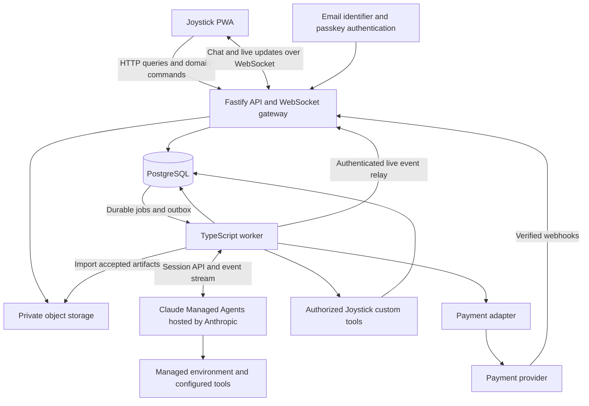

# Joystick technical architecture

Architecture and implementation status · 29 October 2026

Joystick has its own backend. The first-cut architecture is the responsive PWA, a TypeScript API with an integration worker, Claude Managed Agents hosted by Anthropic, WebSockets for chat and live updates, and PostgreSQL. Vercel hosts the frontend; Fly hosts the API and worker. Object storage remains a future addition. The current pilot makes mission creation, plan joining, task submission, two-member review, stage advancement, and a simulated reward durable. It does not move real money or issue ownership.

The core asset is a trustworthy record of useful work: who authorized it, what was produced, who accepted it, and what that acceptance earned. Game progress, money, and ownership derive from that record through separate rules.

## Current baseline

The `codex/joystick-first-cut` branch builds on the earlier account-and-chat foundation. Its `/` flow uses the API for account-backed missions, stages, plans, tasks, claims, submissions, reviews, profiles, and test-credit journal entries. `/chat.html` retains private agent chat. The prototype screens and sample content remain as examples, separate from persistent records. Older `strategy` and `token` names remain in presentation source; the API uses mission, stage, plan, and quest vocabulary. See [game actions](game-actions.md), [account access](account-access.md), and [deployment](deploying.md).

| First-cut behavior | Source and boundary |
| --- | --- |
| Passkey access | `server/auth.ts` and migrations `001`–`003`, `006`–`007`: signup, sign-in, signed-in credential management, and single-use recovery codes; email is unverified. |
| Shared game state | `server/game/service.ts`, `server/game/routes.ts`, migrations `004`, `007`–`010`: membership-scoped commands and snapshots, persistent task artifacts, two distinct registered member reviews of the same version, and owner-attested stage closure. |
| Agent work | `server/agent-runs/`: dynamically selected mission/plan/task context, scoped read and draft/artifact tools, decision requests, cancellation, and durable run history. The worker uses a Managed Agent session when configured; saved output requires a person's review and is not automatically submitted or approved. |
| Chat | `server/chat.ts` and the WebSocket gateway: durable private and scoped room messages with current membership checks. |
| Credits | `server/game/service.ts`: labeled test credits, reservations, XP, journal entries, and payout simulations only. No payment provider, escrow, or ownership issuance is connected. |

The sections below were written as the **target architecture** before the first-cut implementation. They remain useful for later design, but proposed object storage, payment rails, verified matching rounds, ownership, and the full nine-Referee policy are not current pilot features. The pilot instead requires two distinct mission members to review a text artifact and lets the mission owner attest stage completion after its gate. Large files are not yet held in private object storage; bounded text artifacts live in PostgreSQL. Funding and payout labels refer only to simulated credits.

## System shape

The API and integration worker share domain services and migrations. Anthropic runs the agent; the worker dispatches requests, consumes events, answers custom tool calls, and reconciles state after interruptions. PostgreSQL holds business state and reliable integration work. Files hold accepted evidence and outputs; their ownership, version, access scope, and content hash live in PostgreSQL.

| Layer | Choice and status | Why |
| --- | --- | --- |
| Web | Existing Vite, vanilla JavaScript, CSS design system; proposed gradual TypeScript adoption | Preserve the responsive screens and migrate one flow at a time |
| API | Implemented Node.js, TypeScript, Fastify; extend runtime schemas as domain commands arrive | One language across the web and backend, with explicit contracts |
| Agents | Confirmed Claude Managed Agents with Anthropic-hosted cloud environments; access through the Anthropic TypeScript API client `@anthropic-ai/sdk` | Delegate the agent loop, execution environment, and session persistence to Anthropic |
| Live updates | Confirmed WebSockets; proposed `@fastify/websocket` server and native browser WebSocket client | Bidirectional chat, streaming agent replies, typing, and progress |
| Data | Implemented Fly Managed Postgres through `pg`, versioned SQL migrations and explicit transactions | Claims, reservations, and rewards need coordinated updates |
| Jobs | Implemented PostgreSQL-backed integration worker for managed chat; business tools and payment reconciliation follow later | Reliable API dispatch and notifications; agent execution is managed |
| Files | Proposed private S3-compatible object storage | Keep large evidence and artifacts outside database rows |
| Identity | Confirmed email identifier plus passkey signup and login, using SimpleWebAuthn; no email verification or passwords | Passkey possession authenticates the account; email ownership is not asserted |
| Deployment | Confirmed Vercel frontend and Fly API plus integration worker | Anthropic hosts agent execution; Joystick hosts its product services |

The initial frontend retains its existing rendering code. React or Next.js would be a separate decision. The foundation uses explicit SQL without an ORM, a small versioned migration runner, Node's test runner for backend integration tests, and Playwright for browser tests. A payment provider and private object storage provider remain unselected.

The deployment pilot uses one API Machine and one worker Machine on Fly, with Fly Managed Postgres. The existing Vercel production domain stays the frontend address. Vercel proxies HTTP `/api` requests to Fly, keeping host-only login cookies first-party. WebSockets connect directly to Fly using `VITE_WS_ORIGIN` and a short-lived, single-use authentication ticket obtained through the authenticated HTTP API. This works across Vercel and Fly domains without third-party cookies. The API checks the exact frontend `WEB_ORIGIN`; the passkey `RP_ID` is the stable Vercel frontend hostname. See [the deployment guide](deploying.md) for runtime configuration and operational limits.

Fastify provides TypeScript request and response typing; runtime schemas remain necessary because browser and external inputs are untrusted. See the [Fastify TypeScript documentation](https://fastify.dev/docs/latest/Reference/TypeScript/).

Keep the initial backend as a modular monolith: one application with clear internal ownership. Add a dedicated queue, workflow engine, search service, or separate domain service only when measured throughput or workflow complexity warrants it. Blockchain recording is a later adapter, not a prerequisite for playing a quest.

### What managed agents remove from the build

Anthropic supplies the agent harness and hosted execution infrastructure. Joystick configures agents, tools, and environments through the API. The application does not need its own agent container fleet, warm-process pool, Claude Code subprocess manager, or SDK transcript store. This is a deliberate reduction in implementation scope. See the [Managed Agents overview](https://platform.claude.com/docs/en/managed-agents/overview).

Joystick still owns accounts, room access, work acceptance, financial records, and enforcement inside its custom business tools. Keep the provider integration behind one adapter because Managed Agents is currently a beta API; verify account access and pin a compatible client version during the first integration slice.

## Domain modules and records

| Module | Main records | Owns |
| --- | --- | --- |
| Identity and access | Person, Profile, Agent, Membership, CapabilityGrant | Human accountability, agent identity, mission and room access |
| Missions | Mission, Stage, GoalCriterion, Plan, Squad | Goals, plans, eligibility, stage progression |
| Work | Quest, QuestDependency, Claim, Submission, ArtifactVersion | Who is doing the work and what they submitted |
| Review | ReviewAssignment, ReviewDecision, StageCheck, Appeal | Evidence acceptance and independent checks |
| Collaboration | Room, Message, DecisionRequest, Notification | Shared history, human decisions, updates |
| Agent integration | Run, ManagedSession, ProviderEventReceipt, ToolOperation | Provider session mapping, scoped context, costs, event reconciliation, and authorized business effects |
| Funding and rewards | FundingAccount, Reservation, JournalEntry, RewardObligation, Payout | Available funds, commitments, earned pay, settlement |
| Contributions and bonus | Contribution, TrustSnapshot, MatchingRound, Allocation | Verified signals and reproducible bonus allocation |
| Ownership | OwnershipPolicy, Issuance, HoldingSnapshot, Distribution | Agreed mission ownership and revenue allocation |

A person and their agent share the visible profile, but retain separate actor IDs internally. Every agent action records both the agent and accountable human. Squads persist across stages; a plan belongs to one stage and one squad. A quest belongs to one plan, and a part is a child quest. Dependencies must stay within their allowed scope and cannot form cycles.

Model mission membership, squad membership, and plan backing separately. Match the current product's one active squad per person per mission, with dated membership history and an atomic switch; backing a plan does not join its squad. Creating a plan creates its squad and leader relationship together. On a squad switch, reauthorize active claims and runs before they can continue, and retain historical conflicts for review assignment. Profile views expose permitted achievements and work references; they do not expose private chat, wallet records, or restricted mission history.

Quest kind distinguishes `work` from `backing`. Backing is presented as a Patron quest, but uses a per-person backing receipt, not a single globally completed quest. Free backing records a unique verified signal; money backing completes when the payment is confirmed. Neither route starts an agent, reserves a work reward, requires two work reviewers, or advances accepted-work goal progress. The work lifecycle below applies to work quests. Any eventual backing reward uses a separate published policy.

Expose plan blockers as a read model derived from funding, dependencies, staffing, and recorded manual blockers. Each blocker identifies its source, status, relevant role, and optional quest. Personalization changes display order, not who is authorized or eligible to act.

A stage owns versioned success criteria. Accepted outcomes reference the exact evidence and criterion they satisfy. The same outcome cannot advance the same criterion twice just because two plans or a parent and child quest reference it. Numeric scores are projections of accepted outcomes, not writable balances.

Keep structured fields for identity, relationships, state, money, and policies. Use JSON for tool payloads and domain-specific evidence metadata. Do not persist the browser's entire `S` object as the backend model.

## The work lifecycle

Keep these lifecycles separate:

| Entity | Proposed states |
| --- | --- |
| Quest | Open → Claimed → In progress → In review → Accepted; Changes requested loops to In progress; Cancelled is explicit |
| Agent run | Queued → Running → Waiting for human or external result → Running → Succeeded; Failed and Cancelled are explicit |
| Submission | Submitted → Under review → Accepted or Changes requested; a revision creates a new version |
| Stage | Planned → Active → In review → Cleared; Rework, Suspended, and Cancelled are explicit |
| Reward | Reserved → Earned → Payable → Payout pending → Paid; failure, hold, and reversal are separate records |

Plan display statuses remain Racing, Waiting, and Won. Internally record the waiting reason, such as insufficient backing, missing approval, dependency, or funding threshold. A scheduler may reevaluate these conditions, but only server-verified evidence can satisfy them.

### From Start to accepted work

1. **Start:** validate the person's membership, skills where required, plan eligibility, quest dependencies, and current version. Atomically create one active claim, reserve the promised reward and authorized execution budget, create a run, and enqueue its job.
2. **Execute:** the integration worker dispatches the authorized task to a managed session and records the provider ID. Anthropic executes it; Joystick consumes progress independently of the browser. Recover an interrupted connection by reconciling the existing session rather than starting the task again.
3. **Ask:** a decision request records its question, allowed answers, run version, and authorized respondent. Answering it resumes that run once. A stale or duplicate answer cannot resume a replacement run.
4. **Submit:** store immutable artifact versions and a submission manifest. Real-world quests require uploaded evidence; an agent message alone does not prove completion.
5. **Review:** assign two qualified Checkers outside the contributing squad. Selecting Checker as a profile role does not grant review authority. Both must approve the same submission version. Changes create a new version and new review decisions; old approvals cannot carry over silently.
6. **Accept:** in one transaction, accept the submission, record contributions and earned rewards, update unique goal outcomes, and enqueue notifications. Repeating the command produces no additional reward.
7. **Clear the stage:** snapshot the evidence for the Referees. Apply the mission's published review policy, record the final decision, and make only that stage's eligible obligations payable. Activate the next stage while preserving all historical records.

Claims have expiry and renewal rules. Expiry revokes the run's business-tool grant and requests provider interruption before reassignment. Old provider events cannot authorize new effects. If a run has external capabilities that cannot be revoked immediately, hold reassignment until their status is reconciled. Split quests allocate their existing budget across parts; completing the parent cannot mint a second reward.

## Managed agent integration

Create versioned agent definitions and Anthropic-hosted cloud environments, then map each Joystick agent and conversation scope to a managed session. Store its provider ID and configuration version alongside the Joystick run. Anthropic preserves session conversation history and checkpoints the environment when idle. Import submitted outputs into Joystick's artifact store so review evidence remains independently versioned. See [starting sessions](https://platform.claude.com/docs/en/managed-agents/sessions) and [session persistence](https://platform.claude.com/docs/en/managed-agents/events-and-streaming).

The integration worker sends user events, observes session status, and handles requests for Joystick tools. Application restarts recover the existing provider session. Session `idle` can mean waiting for input or a tool result; it is not proof that a quest is complete. Only an explicit submission enters review, and only review acceptance earns a reward. See [session statuses](https://platform.claude.com/docs/en/managed-agents/session-operations).

Preserve the single Start button. It activates a bounded grant covering tools, destinations, data access, spending, and expiry. Custom business tools execute in Joystick services: on a provider custom-tool event, check that grant and current membership, record an operation ID, perform the authorized action, and return the result. Repeated delivery returns the stored result. In-scope actions run automatically; only an actual expansion of authority or a missing human decision pauses for input.

Configure provider permission policies for built-in and MCP tools. They are separate from custom tools, whose execution is the application's responsibility. Use confirmation policies where Joystick must evaluate an external action, and enforce permissions again inside Joystick services. Do not give the managed environment direct database, payout, or unrestricted publishing credentials. Messages and tool output cannot expand these grants. See [Managed Agents permission policies](https://platform.claude.com/docs/en/managed-agents/permission-policies).

Private agent chat and a quest room use separate managed sessions. Serialize ordinary turns within each scope; interruption and redirection are explicit actions. Joystick room messages are the shared product record, while the provider manages agent working context. Recheck access before supplying data or publishing outputs. If visibility changes make existing context unsafe, stop its use and start a clean session with only currently authorized context.

Open the provider event stream before dispatching new input. On reconnect, open a fresh stream, buffer incoming events, fetch paginated event history, and deduplicate the overlap using provider event IDs. Persist the events that drive Joystick state before marking them processed. Treat ambiguous session creation or input dispatch as reconciliation work rather than blindly creating or sending again. See [event delivery and recovery](https://platform.claude.com/docs/en/managed-agents/events-and-streaming).

For responsive replies, opt into `agent.message` event deltas. Forward permitted preview text over Joystick's WebSocket and replace it with the authoritative buffered message when it arrives. Previews are best-effort and may be incomplete; do not use them as evidence of completion. Never relay raw tool payloads or private context into a room. See [event deltas](https://platform.claude.com/docs/en/managed-agents/event-deltas).

Use provider session budgets alongside Joystick's own reservations for paid business tools. Record provider usage and reconcile it with mission budgets. Cancel revokes Joystick grants and interrupts the provider session; it cannot undo completed external actions. Apply per-person and per-mission admission limits. See [session budgets](https://platform.claude.com/docs/en/managed-agents/budgets).

## Money and the bonus

### Funds and obligations

Use a balanced, append-only journal with integer minor units and an explicit currency. Keep prize funding, the stage bonus pool, plan operating money, and player reward obligations in separate accounts. XP and contribution credits are separate from cash. Corrections create reversal entries rather than editing history.

The prize split in the current brief is 70% players, 15% referees, 10% creator, and 5% community fund. Store it as a versioned launch policy. Allocate stage budgets before offering quests, and reserve each quest's maximum advertised payout, including any role multiplier. Never fund a new promise from an uncollected pledge or a live matching estimate.

Freeze applicable role and reward rules at claim time so later profile edits cannot change the payout. The README says role matches pay 2×, while current code multiplies XP and retains the quest's fixed cash amount. Resolve whether the multiplier affects XP, money, or both before publishing real reward amounts.

**Proposed reward rule:** accepted work earns a funded obligation even if its plan loses. Normal release happens when the stage clears. Before live money, choose a release deadline and cancellation rule for a stage that never clears; otherwise the promise that every approved quest pays remains incomplete. The test pilot can exercise both paths without representing test balances as money.

A payment adapter records external references and uses stable operation IDs. Webhooks require signature checks, durable deduplication, and state reconciliation. A requested payout is not paid until confirmed; an unknown provider result is not safe to repeat with a new key. Stripe's documentation, as an example of provider behavior rather than a provider selection, explicitly describes duplicate and unordered deliveries. See [webhook handling](https://docs.stripe.com/webhooks).

Select a provider after fixing the pilot's countries, currency, funding and payout model. The internal ledger is accounting, not proof that funds are legally held in escrow. Reflect only the custody and settlement guarantees the selected arrangement actually provides.

Confirmed receipts may still be refunded or charged back. Record reversals separately and define a reserve or hold policy, who absorbs the resulting shortfall, and when new spending must stop. A funding reversal cannot silently erase an already accepted worker obligation. Resolve that loss policy before accepting live funds.

### Matching rounds

Persist contribution events by verified person, plan, stage round, signal type, and originating evidence. Combine a person's eligible signals before applying the square root. Free backing must be unique per person and plan within the round; a person who gives money and free backing still counts as one contributor. Delivered time and compute require evidence; never infer real usage from a quest title or size.

A round freezes its eligible plans, contribution cutoff, trust weights, rates, pool, and algorithm version. Quotes are estimates with a snapshot time; final allocations are reproducible from the frozen inputs. To break the timing cycle between operating funds and delivered-work signals, propose closing the stage's bonus round at stage acceptance; plans operate on confirmed backing or separately reserved advances until then. If the bonus must fund work upfront, use an explicit earlier cutoff and define which later signals belong to a future round.

Apply the 40% cap to the original pool, redistribute only among eligible uncapped plans, and retain any amount that cannot be allocated. With two eligible plans, at least 20% stays unallocated. With no positive scores, the whole pool stays unallocated. Use deterministic cent rounding without violating the pool or cap.

The README's worked example gives two plans more than 40%; it illustrates an uncapped distribution and must be reconciled before using it as an implementation fixture. The current matching code also estimates other people's contributions from averages. Neither is an authoritative settlement specification.

### Ownership

Keep accepted contribution records now; derive ownership only under a defined policy. The current README describes mission ownership while legacy economy code also describes team stakes. The proposed first ownership model follows the README and supports mission holdings only.

Before issuance, define the owned interest, IP and revenue rights, total supply or dilution rule, eligible contributions, stage multiplier, vesting or reversals, and revenue distribution waterfall. Holdings must reconcile across all owners; a percentage cannot use a denominator containing only the current player's new shares. Free backing's reward remains an open product decision.

Until that policy is settled, show contribution credits in a real pilot and label any ownership preview as provisional. Later on-chain recording should mirror finalized, uniquely identified issuances and handle confirmation and reconciliation independently of quest execution.

## API and event contracts

### Account authentication

Signup collects a display name and email, then creates a passkey. Login identifies the account by email and proves possession of its passkey. Email verification, passwords, emailed login links, and email-only account recovery are out of scope. Store email as unverified; it cannot establish ownership of an organization, trusted-person status, or eligibility for verified matching signals.

Use SimpleWebAuthn for browser registration/authentication and server verification. Challenges expire, are single-use and bound to the initiating browser. Require user verification and validate the expected origin and relying-party ID. Create the account and credential atomically after successful registration. An unauthenticated signup cannot add a credential to an existing email's account. Rate-limit options and verification endpoints. A lost-passkey recovery policy remains a future decision; do not substitute email access silently. See [SimpleWebAuthn server verification](https://simplewebauthn.dev/docs/packages/server).

### Application commands

Expose resource queries and explicit commands, such as `claimQuest`, `answerDecision`, `submitWork`, `reviewSubmission`, `backPlan`, and `finalizeStage`. Each command validates its actor, object scope, expected state or version, and idempotency key. Store the request hash with the key; reuse with a different payload is an error. The browser never supplies authoritative balances, trust weights, accepted status, or payouts.

Use `/api/v1` and generated client types from runtime schemas. Return stable IDs, versions, allowed actions, and machine-readable errors. Paginate history with cursors. Use server sessions with Secure, HttpOnly cookies, CSRF protection for mutations, and explicit session revocation. Escape user content in the existing HTML rendering paths and sanitize any supported rich text before rendering it.

Commit business changes and outbox events together. Event envelopes contain an event ID, object ID and version, event type, actor, timestamp, and access scope. HTTP and WebSocket commands call the same application services. Do not broadcast private event payloads and rely on clients to hide them.

### WebSocket chat and delivery

Use `/api/v1/ws` for authenticated subscriptions, chat sends, typing, run progress, and streaming replies. Keep history queries, uploads, and financial commands on HTTP. `@fastify/websocket` integrates upgrade authentication with Fastify; after upgrade, each frame needs its own schema validation, authorization, and error handling. See the [official plugin documentation](https://github.com/fastify/fastify-websocket).

1. The browser renders an outgoing message immediately with a client-generated ID and Pending state.
2. The gateway validates the session, room membership, message payload, and rate limit. It commits the message, room sequence, and outbox event before acknowledging the send as Saved. A repeated client ID returns the same result; changed content with that ID is rejected.
3. Durable room events are delivered in room order. Separate per-run sequence numbers identify streamed reply chunks. Typing and presence are ephemeral and expire automatically.
4. The integration worker bridges Managed Agents event previews and completed messages to the WebSocket gateway, with run and audience scope checked server-side. Completed messages are durable; preview text is provisional. The browser does not connect directly to Anthropic or hold its credentials. Closing the browser does not cancel a managed session.
5. Reconnect sends the last durable cursor per room and the current run/message version. The server rechecks access, starts buffering live events, and captures a durable high-water sequence. Replay through that sequence, then drain newer buffered events with deduplication before switching to live delivery; a missing sequence triggers durable catch-up. Return the latest assembled reply snapshot as well. Chunk gaps cause a snapshot refresh; final text replaces a draft rather than appending it twice. Cursor retention expiry triggers a full refetch.

The pilot can use one gateway instance and a direct internal worker relay. Durable outbox delivery wakes promptly on committed events and has a recovery scan. Before adding gateway replicas, add a shared fan-out mechanism and cross-instance session revocation; PostgreSQL remains the replay source. No per-token database polling belongs in the interactive path.

Validate the browser Origin against an allowlist during cookie-authenticated upgrades. Check room and run access on subscription, send, replay, and delivery, including changes while a connection stays open. Use heartbeat expiry, reconnect backoff, bounded payloads and send buffers. Drop stale ephemeral events under pressure and disconnect slow consumers with a recoverable cursor instead of buffering indefinitely.

Initial performance targets, to validate rather than promise: local message echo within 50 ms and p95 saved-message acknowledgement below 250 ms in the pilot region. Measure first visible agent output separately, including provider provisioning and model latency. WebSockets and incremental previews address delivery; the hosted runtime's response time must be measured with representative conversations.

Object uploads use short-lived scoped upload grants, size and type limits, and a finalized metadata record. Quarantine untrusted uploads before exposing them to reviewers or tools. Download authorization checks the current object's scope. The service worker must exclude API, authentication, event streams, and signed file routes from its generic cache; logout clears any account-scoped browser state.

## Reliability and operations

Integration jobs are delivered at least once. Claim a job in a short transaction using a lease; do not hold a database transaction open during provider or tool calls. A recovery scan reclaims expired integration jobs, and a fencing token rejects stale worker writes. This worker recovers dispatch and event handling, not the hosted agent process. PostgreSQL documents `SKIP LOCKED` as suitable for multiple consumers of queue-like tables; it is not a general consistency mechanism. See [PostgreSQL SELECT locking](https://www.postgresql.org/docs/current/sql-select.html).

Every external effect has a durable operation record and idempotency key. If an external tool cannot deduplicate, reconcile a timed-out operation or require intervention instead of blindly replaying it. Retry only retryable failures, with bounded attempts and backoff; retain exhausted jobs for inspection. Scheduled scans enforce claim expiry, review deadlines, and reconciliation without depending on an open browser.

Use one region initially, managed database backups and point-in-time recovery, object versioning where required, separate production and test credentials, and reversible deployment steps. Exercise restore before live funding. Use backwards-compatible schema expansion before removing old fields so queued jobs and existing clients survive deployments.

Trace requests through jobs, tool calls, artifacts, and settlements. Track claim conflicts, oldest queued job, stuck runs, review wait time, model costs, failed payouts, and ledger reconciliation differences. Audit operator actions, reviewer replacements, and policy changes. Provide operator controls to pause a mission, disable a tool, stop runs, reassign a reviewer, and inspect a payment without directly editing balances.

## Delivery sequence

| Phase | Deliverable | Exit evidence |
| --- | --- | --- |
| 1. Real shared state | Accounts, memberships, one curated mission and stage, two plans, persistent quests and WebSocket rooms | Two users see the same state; reconnect does not duplicate or lose saved messages; unauthorized access fails; stage history survives reloads |
| 2. Real useful work | Atomic claims, minimal test ledger and budget reservations, one Claude Managed Agents session with scoped custom tools, streamed responses, human decision, artifact storage, two qualified Checkers | Integration restart reconnects to the existing session; repeated tool events do not repeat effects; reviews bind to artifact versions; acceptance records a funded test obligation |
| 3. Complete test settlement | Stage review policy, release and payout simulation, reconciliation, operator tools | Clearing one stage affects only that stage; all journal entries balance; duplicate commands do not double-pay |
| 4. Funded pilot | One supported funding and payout route, reconciled balances, explicit stalled-stage policy | Duplicate and unordered events, unknown provider outcomes, refunds, and payout failures are exercised |
| 5. Broader coordination | Verified matching rounds, needs and pledges, more tools, ownership under an agreed policy | Frozen rounds reproduce exactly; contribution and ownership records reconcile |

The first pilot should use a bounded software or documentation mission with inspectable outputs. Keep the product's intended two-Checker and nine-Referee model visible in the design. If the pilot cannot recruit enough independent reviewers, publish a separate pilot review policy; never simulate missing people or silently reduce the threshold.

Before implementation, decide the Referee approval threshold, conflict rules, replacement process, and appeals window. An owner's thumbs-up remains advisory. Finalization locks the evidence snapshot and must account for open appeals or review holds; acceptance beyond the stage cutoff requires an explicit policy.

Tests should focus on production boundaries: simultaneous claims, repeated submissions, revoked permissions, stale artifact approvals, worker death after an external effect, insufficient budgets, duplicate payment events, parent/part reward duplication, capped matching with zero or two eligible plans, and settling one stage while another still has pending pay.

For chat and Managed Agents integration, test reconnect before acknowledgement, duplicate sends, preview/final message reconciliation, removal from a room while connected, slow consumers, concurrent inputs, provider stream/history overlap, repeated custom tool events, ambiguous dispatch, budget pauses, and recovery after the integration worker restarts. Backing quests need separate tests proving they cannot create work rewards or complete for every backer when one person contributes.

## Proposed repository layout

Keep `src/` as the web application initially. Add `server/` for API routes, domain modules, repositories, adapters, and worker entrypoints; `contracts/` for transport schemas and generated client types; `db/` for migrations; and `tests/` for integration and lifecycle tests. Keep business rules out of route handlers and screen rendering code.

Migrate the quest flow first: the screen sends a command and renders returned state rather than mutating domain objects. Retain mock mode as an explicit demo with separate fixtures. This avoids a frontend rewrite while making it impossible to mistake simulated reviews or money for production records.

## Decisions for the next discussion

Standalone Joystick, Anthropic-hosted Claude Managed Agents, WebSockets, and email-plus-passkey authentication without email verification are confirmed. The remaining stack and rollout above are proposals. The highest-impact remaining choices are:

1. **Payment promise:** what is the release deadline for accepted work if a stage stalls or is cancelled?
2. **Review policy:** what clears a stage, and how do the first missions recruit independent reviewers?
3. **Ownership:** what right does a mission percentage represent, and how does future contribution dilute it?
4. **Pilot boundary:** which mission, countries, currency, and initial agent tools will be supported?

Those choices shape the contracts and funding guarantees. They can be settled before choosing particular identity, model, execution, or payment vendors.
